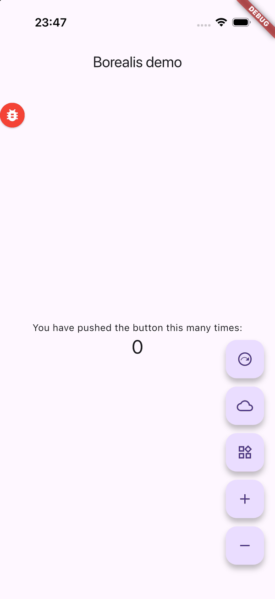
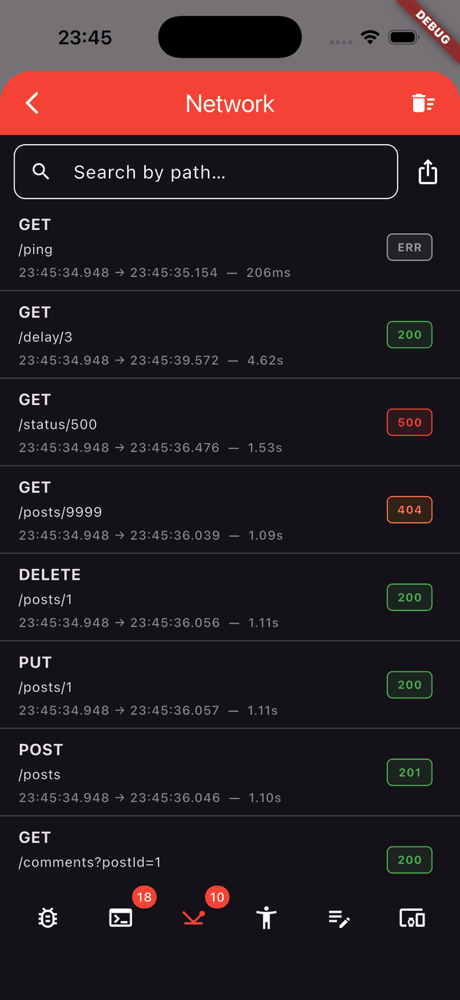
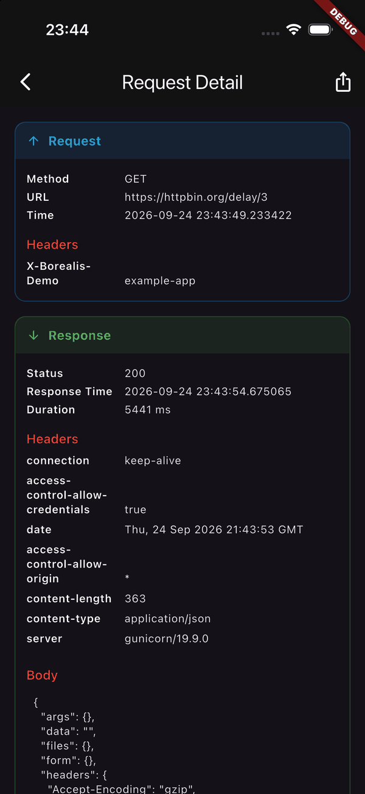
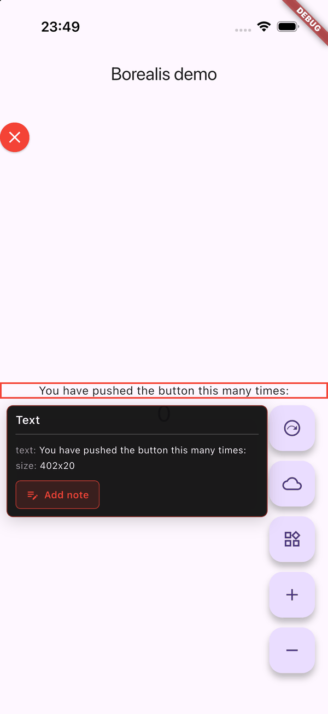

# Borealis

![Borealis ship][borealis_header]

[](https://pub.dev/packages/borealis)
[](https://pub.dev/packages/borealis/score)
[](https://github.com/infinum/flutter-borealis/actions/workflows/ci.yml)
[](LICENSE)

An in-app debugging panel for Flutter. A draggable button floats above your app.
Tap the button to open the panel. You choose which tools the panel holds, and you
can write your own.

> [!WARNING]
> Borealis records the network traffic and the log entries of your app. It can
> export them to the clipboard or to a file. Do not ship Borealis in a production
> build. Read [Security](#security).

## Features

| Tab | What it does |
|---|---|
| **Network** | Every Dio request and response — headers, bodies, timings, status. Search, multi-select, export as a log file or a cURL command |
| **Logs** | Loggy records, colored by level, searchable, exportable |
| **Device info** | App, package, OS and hardware metadata |
| **Rendering** | Flutter's render debug flags as switches — slow animations, repaint rainbow, widget sizes, hitboxes |
| **Annotations** | Tap a widget, attach a note, export all notes as JSON. Capture needs a debug build — see [Build modes](#build-modes) |
| **Debug options** | Your own buttons, toggles, inputs and pickers — global or scoped to one screen. A failed action marks itself and stays usable |
| **Custom pages** | Add your own tab with its own badge, clear action and overlay |

| | | | |
|:--:|:--:|:--:|:--:|
|  |  |  |  |
| The floating button | Captured requests | Request detail | Annotating a widget |

---

## Installation

```sh
flutter pub add borealis
```

Borealis depends on [`dio`](https://pub.dev/packages/dio) and
[`loggy`](https://pub.dev/packages/loggy). The **Network** tab reads Dio traffic,
the **Logs** tab shows Loggy records, and the **Device info** tab uses
`device_info_plus` and `package_info_plus`. `flutter pub add` installs all of them.

Borealis supports **Android** and **iOS**. The panel uses only Flutter widgets, so
it compiles on every Flutter platform, but the file exports need a temporary
directory that web does not have. There they throw `UnsupportedError`.

## Quick start

Three steps, one per data source:

1. **Wrap your app** with `BorealisOverlay` and list the pages you want.
2. **Attach the network logger** to your `Dio` instance, or the **Network** tab stays empty.
3. **Install `BorealisPrinter`** as your Loggy printer, or the **Logs** tab stays empty.

```dart
import 'package:borealis/borealis.dart';
import 'package:dio/dio.dart';
import 'package:flutter/material.dart';
import 'package:loggy/loggy.dart';

final dio = Dio();

void main() {
  Loggy.initLoggy(logPrinter: BorealisPrinter()); // 3 — feeds the Logs tab
  Borealis.initNetworkLogger(dio);                // 2 — feeds the Network tab

  runApp(const MyApp());
}

class MyApp extends StatelessWidget {
  const MyApp({super.key});

  @override
  Widget build(BuildContext context) {
    return MaterialApp(
      builder: (context, child) {
        return BorealisOverlay(                   // 1 — the overlay itself
          pages: const [
            DeviceInfoBorealisPage(),
            LogsBorealisPage(),
            WiretapBorealisPage(),
            RenderingBorealisPage(),
            AnnotationBorealisPage(),
            ActionsBorealisPage(),
          ],
          child: child!,
        );
      },
      home: const HomeScreen(),
    );
  }
}
```

You must pass `pages`. Borealis adds no page on its own, and the list above is
every built-in page. Borealis hosts its own navigator, so the panel opens from
any context and needs no navigator key.

The [`example/`](example/) directory holds a demo app you can run.

## Documentation

The API reference documents every class, parameter and callback:

**[pub.dev/documentation/borealis](https://pub.dev/documentation/borealis/latest/)**

Start from the type that matches your task:

| I want to… | Read |
|---|---|
| Configure the overlay | `BorealisOverlay`, `BorealisSettings` |
| Capture network traffic | `Borealis.initNetworkLogger`, `WiretapInterceptor`, `WiretapConfig` |
| Capture logs | `BorealisPrinter`, `LogsConfig` |
| Add my own debug controls | `ActionsBorealisPage`, `ButtonActionWidget`, `ToggleActionWidget`, `InputActionWidget`, `SelectableActionWidget` |
| Scope controls to one screen | `ScreenDebugActions` |
| Add my own tab | `BorealisPage` |
| Render a body format of my own | `WiretapBodyParser` |
| Send annotations somewhere | `AnnotationExporter` |

---

## Security

Borealis is a debugging tool. It records data that you do not want to disclose,
and it gives the user buttons that export that data. Use Borealis only as a debug
dependency.

**What Borealis records.** The **Network** tab records every Dio request and
response in full, including the URL, the headers and the body. The **Logs** tab
records every log entry your app writes. Borealis holds the most recent 1000 of
each in memory until the process ends.

**Where the data can go.** The cURL export writes the request and its headers to
the clipboard. The log file exports write plain text to `borealis_exports/` in
the system temporary directory and return the file path, which most apps pass to
a share sheet. Borealis deletes the files an earlier run left in that directory
the next time it exports, so at most one session's exports sit on disk. It does
not delete the file it just handed you — that one is yours to move or drop.

**Borealis masks credential headers by default.** It replaces the value of
`Authorization`, `Cookie`, `Set-Cookie`, `Proxy-Authorization` and `X-Api-Key`
with `<redacted>`, before the request reaches the store.

**Body keys are masked only if you name them.** Pass `redactBodyKeys` to mask
matching keys inside request and response bodies, matched without case and
applied through nested maps and lists. There is no default set: a key that is a
credential in one API is ordinary data in the next.

```dart
Borealis.initNetworkLogger(
  dio,
  redactBodyKeys: {'access_token', 'refresh_token', 'password'},
);
```

Masking covers headers and the body keys you name. Borealis records a token in
the URL or in a query parameter in full, and it records every log entry your app
writes in full.

The cURL export reflects what was captured: masked headers come out masked, so
the command is not replayable unless you turned masking off for that build. A
multipart body is rendered as `-F` parts and a binary body is noted rather than
pasted, so the command stays runnable.

**Large bodies are not kept whole.** A binary or text body over 512 KB is
replaced with a marker that states its real size, so a session against an image
or file endpoint cannot retain a thousand payloads. A decoded JSON body is
captured whole, because measuring it would mean walking it.

**Use two switches, not one.** `BorealisSettings(enabled: false)` removes the
overlay, but it does **not** detach the Dio interceptor, which keeps filling the
store with nothing to show it. Disable both:

```dart
import 'package:flutter/foundation.dart'; // kReleaseMode

void main() {
  if (!kReleaseMode) {
    Loggy.initLoggy(logPrinter: BorealisPrinter());
    Borealis.initNetworkLogger(dio);
  }
  runApp(const MyApp());
}

// ...and in the builder:
BorealisOverlay(
  settings: const BorealisSettings(enabled: !kReleaseMode),
  pages: const [/* ... */],
  child: child!,
)
```

**Give testers a build that keeps the token.** Masking is not reversible, so no
switch in the panel can show a token again, and a masked cURL command cannot be
replayed. Turn masking off in the build you hand to testers, and leave it on
everywhere else:

```dart
const captureCredentials = bool.fromEnvironment('BOREALIS_CAPTURE_CREDENTIALS');

Borealis.initNetworkLogger(
  dio,
  redactHeaders: captureCredentials ? const {} : null,
);
```

```sh
flutter build apk --dart-define=BOREALIS_CAPTURE_CREDENTIALS=true
```

One exception survives masking. A **failed** request keeps its original
`DioException` on `WiretapEntry.error`, and that object still references the
unmasked headers. No Borealis screen or export reads those maps, but code that
inspects the entry reaches them.

To report a vulnerability in Borealis, read [SECURITY.md](SECURITY.md).

---

## Build modes

Three features depend on machinery Flutter keeps for debug builds only.

| Feature | Debug | Profile / release |
|---|---|---|
| **Annotations** — tapping a widget to attach a note | Works | Capture is unavailable. The tab says so and lists any notes it already holds |
| **Rendering** — repaint rainbow, widget sizes, hitboxes | Works | The switches do nothing |
| **Rendering** — slow animations | Works | Works. It sets `timeDilation`, which the scheduler applies in every build mode |
| `ScreenDebugActions` — inferring `screenName` from the parent widget | Works | Falls back to the route name, then to `'Unknown screen'`. Pass `screenName` to keep the label |

Annotations resolve a tap to a widget through `RenderObject.debugCreator` and
widget creation locations. Flutter assigns both behind an `assert`, so in a
profile or release build no tap can resolve to anything. Rather than mount a
capture layer that absorbs taps and never selects, Borealis mounts none and the
tab explains itself. A debug build compiled with `--no-track-widget-creation`
still reports capture as available but selects far less; `flutter run` enables
tracking by default.

Everything else — the Network tab, the Logs tab, Device info, Debug options,
custom pages and every export — works in all three build modes. That is the
point of the [Security](#security) section: the tool keeps recording whether or
not you can see it.

---

## Contributing

Bug reports, feature requests and pull requests are welcome. Read
[CONTRIBUTING.md](CONTRIBUTING.md) and the
[code of conduct](CODE_OF_CONDUCT.md). To report a security problem, read
[SECURITY.md](SECURITY.md).

## License

Borealis uses the Apache License, Version 2.0. Read [LICENSE](LICENSE).

---

*Borealis* \ ˌbȯr-ē-ˈa-ləs \

1. an aurora that occurs in earth's northern hemisphere
2. a Healy-class icebreaker used as a research vessel by Aperture Science, introduced in *Half-Life 2: Episode Two*

<p align="center">
  <a href='https://infinum.com'>
    <picture>
        <source srcset="https://assets.infinum.com/brand/logo/static/white.svg" media="(prefers-color-scheme: dark)">
        
    </picture>
  </a>
</p>

[borealis_header]: https://github.com/infinum/flutter-borealis/raw/main/assets/borealis_header.png
